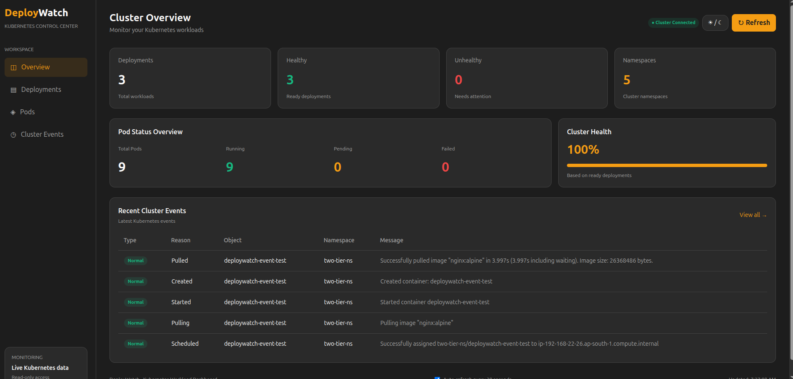
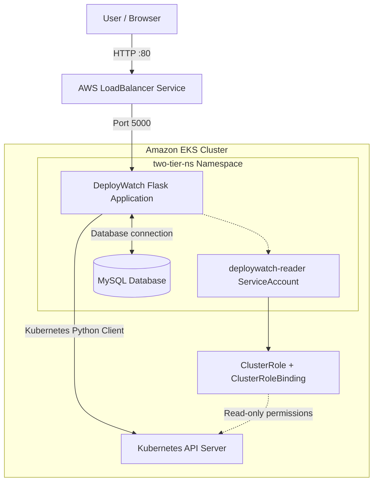
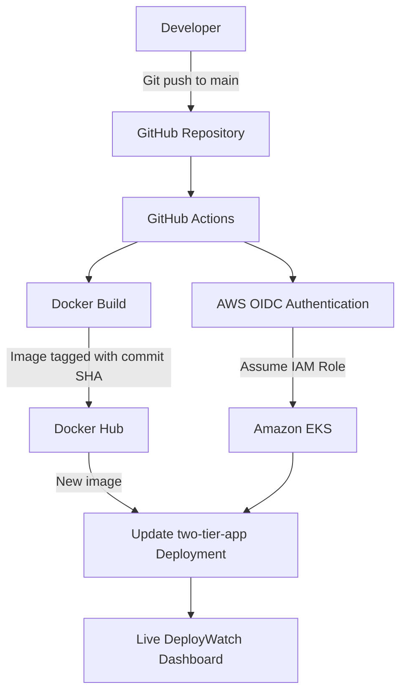

 <div align="center">


# DeployWatch

### Kubernetes Control Center

**A Real-Time Kubernetes Workload Monitoring Dashboard**

[](https://aws.amazon.com/eks/)
[](https://python.org/)
[](https://flask.palletsprojects.com/)
[](https://docker.com/)
[](https://github.com/features/actions)
[](https://aws.amazon.com/)

<br>



<sub>DeployWatch — Kubernetes monitoring interface</sub>

</div>

---

## Overview

DeployWatch is a web-based Kubernetes monitoring dashboard that provides a centralized view of cluster workloads and activity.

Built with Python and Flask, it integrates with the Kubernetes API to retrieve deployment, pod, namespace, and event information from an Amazon Elastic Kubernetes Service (EKS) cluster.

The application runs as a containerized workload on EKS and uses a dedicated read-only Kubernetes ServiceAccount for cluster access.

The project also includes a GitHub Actions CI/CD pipeline that automatically builds and pushes updated Docker images and deploys them to EKS.

## Key Features

- Real-time Kubernetes workload monitoring.
- Cluster overview with deployment and pod statistics.
- Deployment and pod monitoring.
- Namespace filtering and workload search.
- Kubernetes event visibility.
- Automatic dashboard refresh every 30 seconds.
- Dark and light themes.
- Dedicated read-only Kubernetes RBAC permissions.
- Optimized Docker image using Python Slim.
- Automated CI/CD with GitHub Actions and AWS OIDC.
- Automated image deployment to Amazon EKS.

## Tech Stack

| Category | Technology |
|---|---|
| Cloud Platform | AWS |
| Kubernetes | Amazon EKS |
| Backend | Python 3.12, Flask |
| Kubernetes Integration | Kubernetes Python Client |
| Containerization | Docker |
| Container Registry | Docker Hub |
| CI/CD | GitHub Actions |
| Cloud Authentication | AWS IAM, GitHub OIDC |
| Frontend | HTML, CSS, JavaScript |
| Database | MySQL |
| Access Control | Kubernetes RBAC |

## Architecture

DeployWatch follows a containerized application architecture deployed on Amazon EKS.

### Application Architecture



### Application Flow

1. A user accesses the dashboard through the AWS LoadBalancer Service.
2. Traffic reaches the Flask application running inside an EKS pod.
3. The Kubernetes Python client communicates with the Kubernetes API.
4. The application authenticates using its assigned ServiceAccount.
5. Kubernetes RBAC authorizes read-only access to selected resources.
6. The backend provides cluster information through REST API endpoints.
7. The frontend displays the retrieved monitoring information.

## CI/CD Architecture

DeployWatch uses GitHub Actions to automate Docker image building and deployment to Amazon EKS.



### CI/CD Pipeline Flow

1. A code change is pushed to the `main` branch.
2. GitHub Actions starts the deployment workflow.
3. AWS credentials are configured using GitHub OIDC.
4. Docker builds the application image using the optimized Dockerfile.
5. The image is pushed to Docker Hub with the Git commit SHA as its tag.
6. GitHub Actions updates the EKS Deployment with the new image.
7. Kubernetes performs the rolling update.
8. The workflow verifies the deployment rollout status.

**Security:** The pipeline uses an IAM role with restricted permissions and Kubernetes RBAC access limited to the application deployment.

## Kubernetes Access Model

DeployWatch uses a dedicated ServiceAccount and RBAC configuration to access Kubernetes resources.

| Resource | Permission |
|---|---|
| Deployments | get, list, watch |
| Pods | get, list, watch |
| Namespaces | get, list, watch |
| Events | get, list, watch |
| Services | get, list, watch |

The dashboard uses read-only permissions to follow the principle of least privilege.

## Kubernetes Resources

| Resource | Configuration |
|---|---|
| EKS Cluster | `full-stack-cluster` |
| AWS Region | `ap-south-1` |
| Namespace | `two-tier-ns` |
| Application Deployment | `two-tier-app` |
| Application Service | `two-tier-app-service` |
| ServiceAccount | `deploywatch-reader` |
| Application Port | `5000` |
| Service Port | `80` |
| Container Registry | Docker Hub |
| Image Tag | Git commit SHA (CI/CD) |

## Project Structure

```text
k8s-eks-project/
│
├── .github/
│   └── workflows/
│       └── deploywatch-eks.yml
│
├── assets/
│   ├── aws-eks-logo.svg
│   └── deploywatch-dashboard.png
│
├── screenshoot/
│   └── DeployWatch Interface.png
│
├── deploywatch-source/
│   ├── app/
│   │   ├── static/
│   │   ├── templates/
│   │   ├── database.py
│   │   ├── models.py
│   │   └── routes.py
│   │
│   ├── .dockerignore
│   ├── Dockerfile
│   ├── requirements.txt
│   └── run.py
│
├── deploywatch-ci-rbac.yaml
├── deploywatch-rbac.yaml
├── deploywatch-eks-policy.json
├── deploywatch-eks-trust-policy.json
├── namespace.yaml
├── two-tier-app-deployment.yml
├── two-tier-app-svc.yml
├── mysql-configmap.yml
├── mysql-deployment.yml
├── mysql-svc.yml
├── .gitignore
└── README.md
```

## Backend API Endpoints

| Endpoint | Purpose |
|---|---|
| `/api/cluster/overview` | Cluster summary and workload statistics |
| `/api/deployments` | Deployment information |
| `/api/pods` | Pod information |
| `/api/namespaces` | Namespace information |
| `/api/events` | Kubernetes cluster events |

## Dashboard Interface

The dashboard provides four primary monitoring views:

- **Overview:** Cluster health and workload statistics.
- **Deployments:** Deployment information and namespace filtering.
- **Pods:** Pod status, search, and filtering.
- **Cluster Events:** Kubernetes events, reasons, objects, and messages.

Additional interface capabilities include automatic refresh, manual refresh, resource search, and dark/light theme switching.

## Challenges & Solutions

| Challenge | Solution |
|---|---|
| Connecting Flask with Kubernetes | Integrated the Kubernetes Python client |
| Restricting cluster permissions | Configured dedicated read-only RBAC |
| Displaying Kubernetes events | Implemented a dedicated events API |
| Monitoring multiple namespaces | Added namespace-aware filtering |
| Optimizing Docker image size | Migrated to Python Slim base image |
| Automating deployment | Configured GitHub Actions CI/CD |
| Securing AWS authentication | Integrated GitHub OIDC with IAM |
| Restricting deployment permissions | Configured namespace-scoped Kubernetes RBAC |

## Key Learnings

- Deploying containerized applications on Amazon EKS.
- Understanding Kubernetes Deployments, Services, and Namespaces.
- Integrating Flask applications with the Kubernetes API.
- Configuring ServiceAccounts and RBAC permissions.
- Building and optimizing Docker images.
- Automating CI/CD pipelines with GitHub Actions.
- Configuring AWS IAM roles and GitHub OIDC.
- Deploying application updates to EKS.
- Troubleshooting Kubernetes application access and networking.

## Future Improvements

- Integrate Prometheus for resource metrics.
- Add CPU and memory utilization monitoring.
- Introduce historical workload analytics.
- Add configurable alerts and notifications.
- Improve authentication and dashboard access control.
- Implement production-grade WSGI serving and application health probes.

---

<div align="center">

**DeployWatch — Monitor Your Kubernetes Workloads in One Place**

Built with Python, Flask, Docker, GitHub Actions, and Amazon EKS.

</div>
